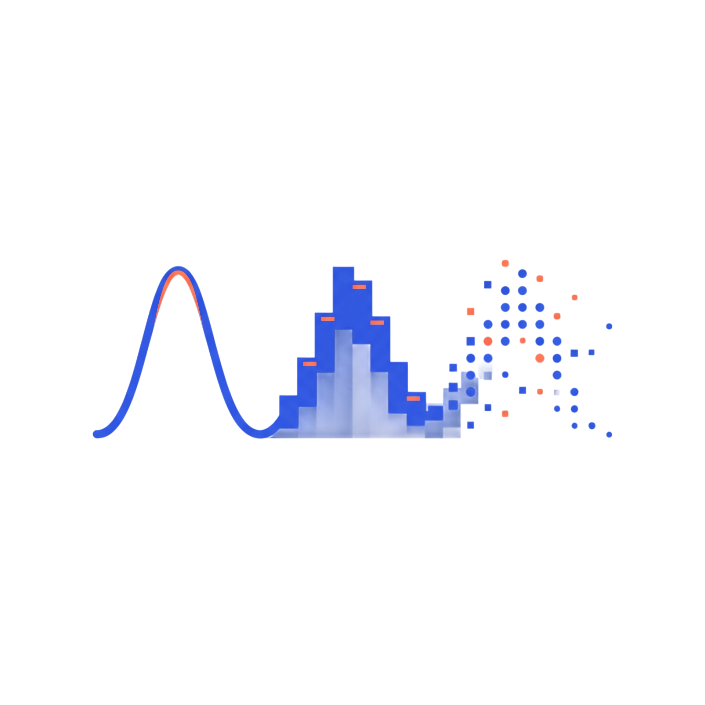

<div align="center">



<h1>Pseudorandomometric Sequences API</h1>

<p><b>Statistical sampling as a REST primitive.</b><br />
Draw up to <b>2,000,000 reproducible values per request</b> from <b>81 univariate distributions</b>
or <b>4 joint multivariate families</b> — as independent streams or correlated vectors — without
shipping a math library to the client.</p>

<p>
  <a href="https://github.com/RedRiotTank/PseudorandomometricSequencesApi"></a>
  <a href="https://spring.io/projects/spring-boot"></a>
  <a href="https://adoptium.net/"></a>
  <a href="https://pseudorandomometricsequences.redriottank.com/api/v1/distributions"></a>
  <a href="https://pseudorandomometricsequences.redriottank.com/swagger"></a>
  <a href="https://commons.apache.org/proper/commons-math/"></a>
  
  <a href="LICENSE"></a>
</p>

<p>
  <a href="#features">Features</a> •
  <a href="#quick-start">Quick Start</a> •
  <a href="#api-reference">Endpoints &amp; Architecture</a> •
  <a href="#supported-distributions">Supported Distributions</a> •
  <a href="#self-hosting--docker">Self-Hosting</a> •
  <a href="#license">License</a>
</p>

</div>

---

## Features

- **85 distributions, one contract.** 81 univariate samplers plus 4 joint multivariate distributions,
  all addressable by name over HTTP.
- **Two RNG backends.** `general` uses `java.util.Random`/Apache Commons Math for throughput;
  `secure` uses `SecureRandom` (SHA1PRNG when available) when unpredictability matters.
- **Reproducible by construction.** Every response echoes the seed used. Request-level seeds are
  factored into per-variable seeds for multi-variable calls, and a variable may pin its own seed.
- **Independent *or* correlated output.** `/sequences` returns independent named streams;
  `/multivariate` returns vectors whose components share a covariance/scale matrix.
- **2,000,000-value budget per request,** enforced before generation so oversized asks fail fast
  with a `400` instead of consuming memory.
- **Self-describing.** Distribution catalogs are served in JSON, and Swagger UI builds the
  `distribution` enum from the Spring beans at startup — no hand-maintained list to drift.
- **Predictable errors.** Structured JSON for `400`, `404`, and `500`, including malformed bodies.
- **Boring to deploy.** Kotlin 1.9.25 on Spring Boot 3.5.6 / JDK 21, packaged as a single jar with a
  Dockerfile; 620+ JUnit 5 tests cover the samplers and controller contracts.

## Why Use This?

**The problem.** `Math.random()` gives you one thing: a uniform double. The moment you need
heavy-tailed latency, bounded proportions, count data, circular measurements, or two features that
must move together, you are implementing, tuning, and validating inverse-CDFs, rejection samplers,
and matrix factorizations — the part of statistics that is easy to get subtly wrong and expensive to
prove right. Doing it inside every service also means every team ships a different, unaudited
sampler.

**The solution.** This service isolates sampling behind a stable HTTP contract. You ask for a
distribution, its parameters, a count, and optionally a seed; you get JSON. Correlated output uses
a real covariance matrix rather than gluing independent streams together. Reproducibility is
first-class, so a simulation can be replayed from the seed recorded in the response. The client
needs nothing but an HTTP library.

| Workload | Endpoint | Why it fits |
| :--- | :--- | :--- |
| Monte Carlo / risk scenarios | `GET /sequence` or `POST /sequences` | Millions of draws per call, replayable via `seed` |
| Synthetic ML feature tables | `POST /sequences` | One named, independently distributed column per variable |
| Correlated features / stress tests | `POST /multivariate` | Off-diagonal covariance produces genuine dependence |
| Allocation, clicks, inventory counts | `POST /multivariate` (`multinomial`) | Count vectors that sum to a fixed number of trials |
| Game loot tables, damage rolls | `GET /sequence` | Discrete and bounded samplers (`zipf`, `binomial`, `triangular`, …) |
| Bayesian priors | `GET /sequence` | `beta`, `half-cauchy`, `scaled-inverse-chi-squared`, … |
| Load and capacity testing | `GET /sequence` | Up to 2M values in one response, no client-side generator cost |
| Physics / detector simulations | `GET /sequence` | `voigt`, `tsallis`, `relativistic-breit-wigner`, `planck`, … |

## Quick Start

> **Hosted vs. this branch.** The hosted instance at
> `https://pseudorandomometricsequences.redriottank.com` currently tracks `master` and exposes the
> univariate endpoints. The independent multi-variable and joint multivariate endpoints below ship on
> `develop`, so run a local build to use them until the next release is tagged.

### 1. One univariate request (hosted, no install)

```bash
curl "https://pseudorandomometricsequences.redriottank.com/api/v1/random/sequence?count=5&distribution=gaussian&param1=100&param2=15&seed=42"
```

```json
{
  "type": "general",
  "count": 5,
  "distribution": "gaussian",
  "seed": 42,
  "sequence": [
    117.12857973209583,
    113.79111923474181,
    85.75200044663656,
    83.39514570400993,
    104.21466457109169
  ]
}
```

The same `seed` plus the same distribution and parameters always yields the same numbers, so the
response is a complete record of how to reproduce it.

### 2. Several independent variables in one round-trip

```bash
curl -X POST "http://localhost:8080/api/v1/random/sequences" \
  -H "Content-Type: application/json" \
  -d '{
    "count": 3,
    "seed": 42,
    "variables": [
      {"name": "temperature", "distribution": "gaussian", "param1": 20, "param2": 2},
      {"name": "humidity",    "distribution": "uniform",  "param1": 30, "param2": 60}
    ]
  }'
```

```json
{
  "type": "general",
  "count": 3,
  "seed": 42,
  "variables": [
    {
      "name": "temperature",
      "distribution": "gaussian",
      "seed": -5025562857975149833,
      "sequence": [18.348598062847998, 14.873942974622274, 18.758087913371156]
    },
    {
      "name": "humidity",
      "distribution": "uniform",
      "seed": -5843495416241995736,
      "sequence": [36.581625993070176, 31.588995610583403, 54.26411894052597]
    }
  ]
}
```

These two streams are **independent**. If temperature and humidity must co-vary, use the joint
endpoint instead.

### 3. Correlated vectors

```bash
curl -X POST "http://localhost:8080/api/v1/random/multivariate" \
  -H "Content-Type: application/json" \
  -d '{
    "count": 3,
    "seed": 42,
    "distribution": "multivariate-normal",
    "mean": [0.0, 0.0],
    "covariance": [[1.0, 0.8], [0.8, 1.0]],
    "variableNames": ["height", "weight"]
  }'
```

```json
{
  "type": "general",
  "count": 3,
  "distribution": "multivariate-normal",
  "dimension": 2,
  "seed": 42,
  "variableNames": ["height", "weight"],
  "sequence": [
    [1.4325228983022713, 1.3330190510448872],
    [-1.3446476540230368, -1.4149154862577822],
    [0.5574866615513397, 0.7380022637698389]
  ]
}
```

The off-diagonal `0.8` is the correlation: both components are drawn together from a single
bivariate normal, not sampled separately.

### 4. From Python

```python
import numpy as np
import requests

BASE = "http://localhost:8080"  # replace with the hosted URL for univariate endpoints

response = requests.post(
    f"{BASE}/api/v1/random/multivariate",
    json={
        "count": 10_000,
        "seed": 2026,
        "distribution": "multivariate-normal",
        "mean": [0.0, 0.0],
        "covariance": [[1.0, 0.8], [0.8, 1.0]],
        "variableNames": ["x", "y"],
    },
    timeout=60,
)
response.raise_for_status()

samples = np.asarray(response.json()["sequence"])
print(samples.shape)            # (10000, 2)
print(np.corrcoef(samples.T))   # [[1.  0.8] [0.8 1. ]] up to sampling noise
```

Any HTTP client works; there is no SDK to install and no authentication.

## API Reference

| Method | Path | Purpose | Hosted (`master`) | `develop` |
| :--- | :--- | :--- | :---: | :---: |
| `GET` | `/api/v1/random/sequence` | One univariate sequence | ✅ | ✅ |
| `POST` | `/api/v1/random/sequences` | Independent named sequences | — | ✅ |
| `POST` | `/api/v1/random/multivariate` | Joint vector samples | — | ✅ |
| `GET` | `/api/v1/distributions` | Univariate catalog | ✅ | ✅ |
| `GET` | `/api/v1/distributions/multivariate` | Joint catalog | — | ✅ |
| `GET` | `/swagger` | Redirect to Swagger UI | ✅ | ✅ |
| `GET` | `/swagger-ui.html`, `/swagger-ui/index.html` | Swagger UI | ✅ | ✅ |
| `GET` | `/v3/api-docs` | OpenAPI 3 document | ✅ | ✅ |

There is no Actuator dependency and no `/actuator/health`. For a liveness probe, use
`GET /api/v1/distributions` (returns `200` and a JSON array) or `GET /v3/api-docs`.

### Univariate: `GET /api/v1/random/sequence`

| Parameter | Type | Default | Constraints |
| :--- | :--- | :--- | :--- |
| `count` | integer | `10` | `1 … 2,000,000` |
| `type` | string | `general` | `general` or `secure` (case-insensitive) |
| `distribution` | string | `uniform` | Any of the 81 names; case-insensitive |
| `param1` | double | distribution-specific | See [Supported Distributions](#supported-distributions) |
| `param2` | double | distribution-specific | See the catalog |
| `param3` | double | distribution-specific | See the catalog |
| `seed` | long | generated | Echoed in the response; replay with the same value |

Response fields:

| Field | Type | Meaning |
| :--- | :--- | :--- |
| `type` | string | RNG backend actually used |
| `count` | integer | Number of samples |
| `distribution` | string | Requested distribution name |
| `seed` | long | Seed used for this sequence |
| `sequence` | number[] | The generated values |

Seeding behavior:

- **`seed` omitted** — a seed is obtained from the selected backend (thread-local PRNG for `general`,
  a process-wide `SecureRandom` for `secure`) and returned in the response.
- **`seed` supplied** — deterministic output for a given backend, distribution, and parameters.
  `secure` seeds a `SecureRandom` instance; if SHA1PRNG is unavailable the service falls back to
  `java.util.Random`.

### Independent multi-variable: `POST /api/v1/random/sequences`

Every requested variable is sampled independently, with its own RNG instances and its own seed.
Nothing is shared between variables except the request envelope.

Request body:

| Field | Type | Default | Notes |
| :--- | :--- | :--- | :--- |
| `count` | integer | `10` | Samples **per variable**, `1 … 2,000,000` |
| `type` | string | `general` | `general` or `secure` |
| `seed` | long | generated | Master seed for per-variable derivation |
| `variables` | array | — | Required and non-empty |
| `variables[].name` | string | `variable1`, `variable2`, … | Must be non-blank and unique |
| `variables[].distribution` | string | — | Required |
| `variables[].param1` | double | distribution-specific | — |
| `variables[].param2` | double | distribution-specific | — |
| `variables[].param3` | double | distribution-specific | — |
| `variables[].seed` | long | derived | Overrides the derived seed for this variable only |

**Hierarchical seeding.** The service draws one `long` per variable, in request order, from a
`java.util.Random` initialized with the master seed. A variable that supplies its own `seed` uses
that value instead — but the derivation still advances for every variable, so adding an explicit
seed to one variable does not shift the derived seeds of the others.

Response body:

| Field | Type | Notes |
| :--- | :--- | :--- |
| `type` | string | RNG backend |
| `count` | integer | Samples per variable |
| `seed` | long | Master seed used |
| `variables[].name` | string | Resolved name (`variableN` if omitted) |
| `variables[].distribution` | string | Normalized (lowercase) name |
| `variables[].seed` | long | Seed actually used for this variable |
| `variables[].sequence` | number[] | That variable's samples |

Validation notes:

- Empty `variables`, blank names, and duplicate names return `400`.
- `count × variables.length` must be `≤ 2,000,000`; otherwise:
  `Total samples across all variables cannot be greater than 2,000,000`.

### Joint multivariate: `POST /api/v1/random/multivariate`

Returns one **vector** per observation. Components inside a vector may be statistically dependent.

| | `POST /sequences` | `POST /multivariate` |
| :--- | :--- | :--- |
| Output shape | One array per variable | One array per observation |
| Dependence | None | Encoded by covariance/scale/concentration |
| Parameters | Univariate `param1…3` | Joint parameters below |
| Typical use | Feature tables | Correlated simulations |

Request body:

| Field | Type | Default | Applies to |
| :--- | :--- | :--- | :--- |
| `count` | integer | `10` | All; `1 … 2,000,000` observations |
| `type` | string | `general` | All |
| `seed` | long | generated | All |
| `distribution` | string | — | Required: `multivariate-normal`, `multivariate-t`, `dirichlet`, `multinomial` |
| `mean` | double[] | zeros | `multivariate-normal`, `multivariate-t` |
| `covariance` | double[][] | — | Required for normal/t; symmetric positive-definite |
| `degreesOfFreedom` | double | — | Required for `multivariate-t`; `ν > 0` |
| `concentration` | double[] | — | Required for `dirichlet`; every `α > 0` |
| `trials` | integer | — | Required for `multinomial`; `≥ 0` |
| `probabilities` | double[] | — | Required for `multinomial`; non-negative, sums to `1` |
| `variableNames` | string[] | `x1`, `x2`, … | Optional; length must equal the dimension |

Joint distributions:

| Name | Required fields | Constraints | Output |
| :--- | :--- | :--- | :--- |
| `multivariate-normal` | `covariance` (`mean` optional) | Covariance symmetric and positive-definite; `mean` length = dimension | Real-valued vectors, correlated when off-diagonals ≠ 0 |
| `multivariate-t` | `covariance`, `degreesOfFreedom` | Positive-definite scale matrix; `ν > 0` | Heavy-tailed real vectors sharing the scale matrix |
| `dirichlet` | `concentration` | Every `α > 0` | Probability vectors: non-negative, sum to `1` |
| `multinomial` | `trials`, `probabilities` | `trials ≥ 0` integer; probabilities `≥ 0` and sum to `1` within `1e-6` | Count vectors (as doubles) summing to `trials` |

Response fields: `type`, `count`, `distribution`, `dimension`, `seed`, `variableNames`, and
`sequence` (an array of `count` vectors, each of length `dimension`).

**Limits.** `count × dimension` must be `≤ 2,000,000`; otherwise:
`Total number of generated values cannot be greater than 2,000,000`.

#### Example: Dirichlet probability vectors

```bash
curl -X POST "http://localhost:8080/api/v1/random/multivariate" \
  -H "Content-Type: application/json" \
  -d '{
    "count": 3,
    "seed": 7,
    "distribution": "dirichlet",
    "concentration": [2.0, 5.0, 3.0]
  }'
```

```json
{
  "type": "general",
  "count": 3,
  "distribution": "dirichlet",
  "dimension": 3,
  "seed": 7,
  "variableNames": ["x1", "x2", "x3"],
  "sequence": [
    [0.195175099687544, 0.44883850459662844, 0.3559863957158276],
    [0.05991800718919233, 0.5088047652973292, 0.4312772275134785],
    [0.07347469740341428, 0.5738871910395134, 0.35263811155707236]
  ]
}
```

Each row sums to `1.0`. For count data, switch to `"multinomial"` with `trials` and
`probabilities`.

#### Example: multinomial counts

```bash
curl -X POST "http://localhost:8080/api/v1/random/multivariate" \
  -H "Content-Type: application/json" \
  -d '{
    "count": 2,
    "seed": 9,
    "distribution": "multinomial",
    "trials": 10,
    "probabilities": [0.2, 0.3, 0.5]
  }'
```

```json
{
  "type": "general",
  "count": 2,
  "distribution": "multinomial",
  "dimension": 3,
  "seed": 9,
  "variableNames": ["x1", "x2", "x3"],
  "sequence": [
    [3.0, 4.0, 3.0],
    [3.0, 3.0, 4.0]
  ]
}
```

#### 3D visualization asset


The committed render was produced from 50,000 API samples. Reproduce it with the API running:

```bash
python3 scripts/render_multivariate_normal_3d.py \
  --url http://localhost:8080 \
  --count 50000 \
  --seed 2026 \
  --correlation 0.8 \
  --output visualizations/multivariate_normal_3d.png
```

The script requires `numpy` and `matplotlib`. It estimates the empirical density on a grid, draws the
surface, and projects the sample cloud onto the floor.

### Discovery and documentation

```bash
# All univariate distributions, sorted by name
curl http://localhost:8080/api/v1/distributions

# All joint distributions
curl http://localhost:8080/api/v1/distributions/multivariate
```

Each entry contains `name` and a one-line `description` of its parameters, for example:

```json
[
  {
    "name": "dirichlet",
    "description": "concentration = concentration vector α (all values > 0); samples are probability vectors summing to 1"
  },
  {
    "name": "multinomial",
    "description": "trials = number of trials n (>= 0), probabilities = category probability vector p (must sum to 1.0)"
  }
]
```

Interactive docs:

- `GET /swagger` → redirects to `/swagger-ui.html` → `/swagger-ui/index.html`
- `GET /v3/api-docs` → machine-readable OpenAPI 3 document

The `distribution` enum in Swagger is generated from the registered Spring beans, so it always
matches what the service can actually sample.

### Error model

All handled errors return the same JSON envelope:

```json
{
  "timestamp": "2026-10-28T14:34:13.079692478",
  "message": "Invalid Distribution: nope. Use one of the supported types.",
  "details": "uri=/api/v1/random/sequence"
}
```

| Status | Trigger |
| :--- | :--- |
| `400` | Invalid count, unknown distribution, invalid type, out-of-range parameter, duplicate/blank variable names, non-positive-definite covariance, malformed or missing JSON body |
| `404` | Unknown path |
| `500` | Unexpected server error; stable JSON envelope, no stack trace leakage |

### Architecture

```
src/main/kotlin/htt/pseudorandomometricsequencesapi/
├── controller/
│   ├── RandomController.kt              # GET /sequence, POST /sequences
│   ├── MultivariateRandomController.kt  # POST /multivariate
│   ├── DistributionController.kt        # GET /distributions[/multivariate]
│   ├── DistributionSwaggerCustomizer.kt # builds Swagger enum from factories
│   └── HomeController.kt                # /swagger redirect
├── domain/
│   ├── RandomService.kt                 # univariate + independent streams
│   ├── MultivariateRandomService.kt     # joint vectors
│   ├── RandomSourceFactory.kt           # general/secure RNG creation
│   ├── distribution/                    # 81 factories + generators
│   └── multivariate/                    # 4 joint factories + generators
└── handler/GlobalExceptionHandler.kt    # 400/404/500 JSON
```

Request flow: controller → service → `DistributionFactory`/`MultivariateDistributionFactory` →
`SequenceGenerator`/`MultivariateSequenceGenerator`. Factories are plain `@Component`s; Spring
injects the full list into the services at startup.

**Adding a distribution** requires no wiring: implement `DistributionFactory` (or
`MultivariateDistributionFactory`), annotate the class with `@Component`, and give it a unique
lowercase `name`. It is immediately available through the API and appears in both the catalog and
Swagger.

## Supported Distributions

The service exposes **81 univariate distributions** and **4 joint multivariate distributions**.
Names are case-insensitive. `param1`, `param2`, and `param3` are positional; their meaning and
defaults are listed per distribution. Integer parameters are parsed from JSON numbers and must be
whole values (`10` is valid, `10.5` is not). All samples are serialized as JSON numbers, including
discrete counts (`3.0`).

<details>
<summary><b>Click to expand the full catalog of 81 distributions</b></summary>

### Continuous distributions

Location-scale, bounded, and positive continuous samplers.

| Distribution | Parameters and defaults | Validation |
| :--- | :--- | :--- |
| `arcsine` | `param1` = lower bound a (def. 0.0), `param2` = upper bound b (def. 1.0) | `a < b` |
| `bates` | `param1` = count n [integer] (def. 12) — mean of n uniforms; output in [0,1] | integer `n ≥ 1` |
| `beta` | `param1` = shape α (def. 1.0), `param2` = shape β (def. 1.0) | `α > 0`, `β > 0` |
| `chi` | `param1` = degrees of freedom k (def. 1.0) | `k > 0` |
| `chi-squared` | `param1` = degrees of freedom k (def. 1.0) | `k > 0` |
| `double-weibull` | `param1` = shape k (def. 2.0), `param2` = scale λ (def. 1.0) — symmetric Weibull around 0 | `k > 0`, `λ > 0` |
| `erlang` | `param1` = shape k [integer] (def. 1), `param2` = rate λ (def. 1.0) | integer `k ≥ 1`, `λ > 0` |
| `exponential` | `param1` = rate λ (def. 1.0) | `λ > 0` |
| `f-distribution` | `param1` = numerator df d1 (def. 5.0), `param2` = denominator df d2 (def. 5.0) | `d1 > 0`, `d2 > 0` |
| `folded-normal` | `param1` = mean μ (def. 0.0), `param2` = std. deviation σ (def. 1.0) — absolute value of Normal | `σ > 0` |
| `gamma` | `param1` = shape k (def. 1.0), `param2` = scale θ (def. 1.0) | `k > 0`, `θ > 0` |
| `gaussian` | `param1` = mean μ (def. 0.0), `param2` = std. deviation σ (def. 1.0) | `σ > 0` |
| `generalized-gamma` | `param1` = scale a (def. 1.0), `param2` = shape d (def. 1.0), `param3` = power p (def. 1.0; p=1=Gamma, d=p=Weibull) | `a > 0`, `d > 0`, `p > 0` |
| `generalized-normal` | `param1` = location μ (def. 0.0), `param2` = scale σ (def. 1.0), `param3` = shape β (def. 2.0; 2=Gaussian, 1=Laplace) | `σ > 0`, `β > 0` |
| `half-normal` | `param1` = scale σ (def. 1.0) | `σ > 0` |
| `hyperbolic-secant` | `param1` = location μ (def. 0.0), `param2` = scale σ (def. 1.0) | `σ > 0` |
| `inverse-gaussian` | `param1` = mean μ (def. 1.0), `param2` = shape λ (def. 1.0) | `μ > 0`, `λ > 0` |
| `irwin-hall` | `param1` = count n [integer] (def. 12) — sum of n uniforms; n=12 approximates N(6,1) | integer `n ≥ 1` |
| `kumaraswamy` | `param1` = shape a (def. 2.0), `param2` = shape b (def. 2.0) — output in (0,1) | `a > 0`, `b > 0` |
| `laplace` | `param1` = location μ (def. 0.0), `param2` = scale b (def. 1.0) | `b > 0` |
| `log-logistic` | `param1` = scale α (def. 1.0), `param2` = shape β (def. 1.0) | `α > 0`, `β > 0` |
| `logistic` | `param1` = location μ (def. 0.0), `param2` = scale s (def. 1.0) | `s > 0` |
| `lognormal` | `param1` = log-mean μ (def. 0.0), `param2` = log-sigma σ (def. 1.0) | `σ > 0` |
| `noncentral-chi-squared` | `param1` = degrees of freedom k (def. 3.0), `param2` = non-centrality λ ≥ 0 (def. 1.0) | `k > 0`, `λ ≥ 0` |
| `rayleigh` | `param1` = scale σ (def. 1.0) | `σ > 0` |
| `reciprocal` | `param1` = lower bound a > 0 (def. 0.1), `param2` = upper bound b (def. 1.0) — uniform on log scale | `a > 0`, `b > a` |
| `scaled-inverse-chi-squared` | `param1` = degrees of freedom ν (def. 3.0), `param2` = scale τ² (def. 1.0) — conjugate prior for Normal variance | `ν > 0`, `τ² > 0` |
| `skew-normal` | `param1` = location ξ (def. 0.0), `param2` = scale ω (def. 1.0), `param3` = shape α (def. 0.0; 0=symmetric Normal) | `ω > 0` |
| `trapezoidal` | `param1` = min a (def. 0.0), `param2` = max d (def. 1.0), `param3` = plateau fraction in (0,1] (def. 0.5; 1=Uniform, →0=Triangular) | `a < d`, `0 < frac ≤ 1` |
| `triangular` | `param1` = min a (def. 0.0), `param2` = mode c (def. 0.5), `param3` = max b (def. 1.0) | `a < b`, `a ≤ c ≤ b` |
| `truncated-normal` | `param1` = mean μ (def. 0.0), `param2` = std. deviation σ (def. 1.0), `param3` = half-width in σ units w (def. 3.0) | `σ > 0`, `w > 0` |
| `tukey-lambda` | `param1` = shape λ (def. 0.0; 0=logistic, 0.14≈normal, 0.5=U-shaped, 1=uniform on [-1,1]) | — |
| `uniform` | `param1` = min a (def. 0.0), `param2` = max b (def. 1.0) | `a < b` |
| `weibull` | `param1` = shape k (def. 1.0), `param2` = scale λ (def. 1.0) | `k > 0`, `λ > 0` |

### Heavy-tailed & extreme value

Tail-heavy, power-law, and extreme-value models for rare events.

| Distribution | Parameters and defaults | Validation |
| :--- | :--- | :--- |
| `burr` | `param1` = shape c (def. 1.0), `param2` = shape k (def. 1.0) | `c > 0`, `k > 0` |
| `cauchy` | `param1` = location x₀ (def. 0.0), `param2` = scale γ (def. 1.0) | `γ > 0` |
| `frechet` | `param1` = shape α (def. 1.0), `param2` = scale σ (def. 1.0), `param3` = location μ (def. 0.0) | `α > 0`, `σ > 0` |
| `generalized-pareto` | `param1` = location μ (def. 0.0), `param2` = scale σ (def. 1.0), `param3` = shape ξ (def. 0.0; 0=Exponential, >0=heavy tail, <0=bounded) | `σ > 0` |
| `gev` | `param1` = location μ (def. 0.0), `param2` = scale σ (def. 1.0), `param3` = shape ξ (def. 0.0; 0=Gumbel, >0=Fréchet-type, <0=bounded) | `σ > 0` |
| `gompertz` | `param1` = shape η (def. 1.0), `param2` = rate b (def. 1.0) | `η > 0`, `b > 0` |
| `gumbel` | `param1` = location μ (def. 0.0), `param2` = scale β (def. 1.0) | `β > 0` |
| `half-cauchy` | `param1` = scale γ (def. 1.0) — positive half of Cauchy; common Bayesian scale prior | `γ > 0` |
| `landau` | `param1` = location μ (def. 0.0), `param2` = scale σ (def. 1.0) — asymmetric; no finite mean | `σ > 0` |
| `levy` | `param1` = location μ (def. 0.0), `param2` = scale c (def. 1.0) | `c > 0` |
| `log-laplace` | `param1` = log-location μ (def. 0.0), `param2` = log-scale b (def. 1.0) | `b > 0` |
| `lomax` | `param1` = shape α (def. 1.0), `param2` = scale λ (def. 1.0) | `α > 0`, `λ > 0` |
| `moyal` | `param1` = location μ (def. 0.0), `param2` = scale σ (def. 1.0) — closed-form Landau approximation | `σ > 0` |
| `pareto` | `param1` = scale xm (def. 1.0), `param2` = shape α (def. 1.0) | `xm > 0`, `α > 0` |
| `slash` | `param1` = location μ (def. 0.0), `param2` = scale σ (def. 1.0) — heavier tails than Cauchy | `σ > 0` |
| `t-student` | `param1` = degrees of freedom ν (def. 10.0) | `ν > 0` |

### Discrete distributions

Integer-valued outcomes (serialized as JSON numbers).

| Distribution | Parameters and defaults | Validation |
| :--- | :--- | :--- |
| `benford` | — (no parameters) | — |
| `bernoulli` | `param1` = probability p (def. 0.5) | `0 ≤ p ≤ 1` |
| `beta-binomial` | `param1` = trials n [integer] (def. 10), `param2` = Beta shape α (def. 1.0), `param3` = Beta shape β (def. 1.0) | integer `n ≥ 1`, `α > 0`, `β > 0` |
| `beta-negative-binomial` | `param1` = successes r [integer] (def. 1), `param2` = Beta shape α (def. 2.0), `param3` = Beta shape β (def. 1.0) | integer `r ≥ 1`, `α > 0`, `β > 0` |
| `binomial` | `param1` = trials n [integer] (def. 10), `param2` = probability p (def. 0.5) | integer `n ≥ 1`, `0 ≤ p ≤ 1` |
| `conway-maxwell-poisson` | `param1` = rate λ (def. 2.0), `param2` = dispersion ν (def. 1.0; ν=1=Poisson, ν<1=overdispersed, ν>1=underdispersed) | `λ > 0`, `ν ≥ 0` |
| `discrete-uniform` | `param1` = lower bound a [integer] (def. 0), `param2` = upper bound b [integer] (def. 9) | integer `a`, `b`; `b ≥ a` |
| `geometric` | `param1` = probability p (def. 0.5) — models number of failures before first success | `0 < p ≤ 1` |
| `hypergeometric` | `param1` = population N [integer] (def. 100), `param2` = successes K [integer] (def. 50), `param3` = draws n [integer] (def. 10) | integers `N ≥ 1`, `K ≥ 0`, `n ≥ 0`; `K ≤ N`, `n ≤ N` |
| `logarithmic` | `param1` = probability p in (0,1) (def. 0.5) | `0 < p < 1` |
| `negative-binomial` | `param1` = successes r [integer] (def. 1), `param2` = probability p (def. 0.5) | integer `r ≥ 1`, `0 < p ≤ 1` |
| `negative-hypergeometric` | `param1` = population N [integer] (def. 50), `param2` = successes K [integer] (def. 25), `param3` = target successes r [integer] (def. 5) | integers `N ≥ 1`, `K ≥ 0`, `r ≥ 1`; `K ≤ N`, `r ≤ K` |
| `poisson` | `param1` = mean λ (def. 1.0) | `λ > 0` |
| `rademacher` | — (no parameters) | — |
| `skellam` | `param1` = Poisson rate μ₁ (def. 1.0), `param2` = Poisson rate μ₂ (def. 1.0) — difference of two Poissons | `μ₁ > 0`, `μ₂ > 0` |
| `yule-simon` | `param1` = shape ρ (def. 1.5) — power-law; mean = ρ/(ρ-1) for ρ > 1 | `ρ > 0` |
| `zipf` | `param1` = number of elements n [integer] (def. 10), `param2` = exponent s (def. 1.0) | integer `n ≥ 1`, `s > 0` |

### Scientific, physics & engineering

Specialised models from physics, communications, and spectroscopy.

| Distribution | Parameters and defaults | Validation |
| :--- | :--- | :--- |
| `argus` | `param1` = endpoint c (def. 1.0), `param2` = shape χ ≥ 0 (def. 1.0) — B-meson continuum background | `c > 0`, `χ ≥ 0` |
| `bose-einstein` | `param1` = ε/kT > 0 (def. 1.0) — boson occupation number; mean = 1/(exp(ε/kT) − 1) | `ε/kT > 0` |
| `crystal-ball` | `param1` = transition α > 0 (def. 1.5), `param2` = power-law index n > 1 (def. 2.0) — standard form μ=0 σ=1 | `α > 0`, `n > 1` |
| `fermi-dirac` | `param1` = ε/kT (def. 1.0; can be negative) — returns 0 or 1; P(1) = 1/(exp(ε/kT)+1) | — |
| `maxwell-boltzmann` | `param1` = scale σ (def. 1.0) — models speed of gas molecules | `σ > 0` |
| `maxwell-juttner` | `param1` = dimensionless temperature θ = kT/mc² (def. 1.0) — relativistic Maxwell-Boltzmann | `θ > 0` |
| `nakagami` | `param1` = shape m ≥ 0.5 (def. 1.0), `param2` = spread Ω (def. 1.0) | `m ≥ 0.5`, `Ω > 0` |
| `planck` | `param1` = temperature T in kT units (def. 1.0) — blackbody photon energies | `T > 0` |
| `relativistic-breit-wigner` | `param1` = pole mass m₀ (def. 1.0), `param2` = decay width Γ (def. 0.1) — particle resonances | `m₀ > 0`, `Γ > 0` |
| `rice` | `param1` = non-centrality ν ≥ 0 (def. 0.0), `param2` = scale σ (def. 1.0) | `ν ≥ 0`, `σ > 0` |
| `tsallis` | `param1` = temperature T (def. 0.1 GeV), `param2` = exponent n > 1 (def. 7.0) — hadron pT spectra | `T > 0`, `n > 1` |
| `voigt` | `param1` = location μ (def. 0.0), `param2` = Gaussian σ (def. 1.0), `param3` = Lorentzian γ (def. 0.5) | `σ > 0`, `γ > 0` |
| `wigner-semicircle` | `param1` = radius R (def. 1.0) — output in [-R, R] | `R > 0` |

### Circular

Angular data.

| Distribution | Parameters and defaults | Validation |
| :--- | :--- | :--- |
| `von-mises` | `param1` = mean direction μ [radians] (def. 0.0), `param2` = concentration κ (def. 1.0) | `κ ≥ 0` |

</details>

Quick reference for the most common samplers:

| Goal | Distribution | Example parameters |
| :--- | :--- | :--- |
| Symmetric bell curve | `gaussian` | `param1=0&param2=1` |
| Positive right-skewed | `lognormal` | `param1=0&param2=0.5` |
| Bounded proportion | `beta` | `param1=2&param2=5` |
| Counts in a window | `binomial` | `param1=10&param2=0.5` |
| Time between events | `exponential` | `param1=2` (rate) |
| Power-law tails | `pareto` | `param1=1&param2=3` |
| Angles | `von-mises` | `param1=0&param2=4` |

## Self-Hosting & Docker

### Prerequisites

| Tool | Version | Needed for |
| :--- | :--- | :--- |
| JDK | 21 (Temurin recommended) | Build and run |
| Maven | 3.9+ (wrapper pins 3.9.11) | Build |
| Docker | 20+ | Container image |
| Python | 3.10+ with `numpy`, `matplotlib` | Only the 3D visualization script |

### Run from source

```bash
git clone https://github.com/RedRiotTank/PseudorandomometricSequencesApi.git
cd PseudorandomometricSequencesApi
git checkout develop

chmod +x mvnw        # the wrapper is checked in without the executable bit
./mvnw spring-boot:run
```

The API listens on `http://localhost:8080` (Spring Boot default; no port is set in
`application.properties`). Swagger is at `http://localhost:8080/swagger`.

Run the test suite:

```bash
./mvnw test
```

The build compiles Kotlin with the Spring all-open plugin and, during `prepare-package`, generates
Dokka HTML docs into `target/dokka/html`.

### Docker

The `Dockerfile` is a thin runtime image (`eclipse-temurin:21-jre-jammy`) that expects an already
built jar:

```bash
# 1. Build the fat jar
./mvnw clean package -DskipTests

# 2. Build the image. JAR_VERSION is optional when exactly one jar is in target/
docker build -t pseudorandom-api:latest .

# ...or pin the version explicitly
docker build --build-arg JAR_VERSION=0.7.1-SNAPSHOT -t pseudorandom-api:latest .

# 3. Run
docker run --rm -p 8080:8080 pseudorandom-api:latest
```

`docker-compose.yml` in this repository is the maintainer's homelab configuration, not a generic
one:

- it publishes **`8081:8080`**, not `8080:8080`;
- it attaches the container to an **external** Docker network named `monitoring`;
- it adds Promtail logging labels.

For a standalone deployment, create the network or trim that section first:

```bash
docker network create monitoring   # only needed if you keep the network block
docker compose up -d               # API on http://localhost:8081
```

### Raising the generation limit

The 2,000,000-value ceiling is a plain constant per service. For a private, unrestricted instance,
edit both values and their messages:

```kotlin
// src/main/kotlin/.../domain/RandomService.kt
const val MAX_SAMPLES_PER_REQUEST = 2_000_000

// src/main/kotlin/.../domain/MultivariateRandomService.kt
const val MAX_VALUES_PER_REQUEST = 2_000_000
```

Keep the two `MAX_*_MESSAGE` strings in sync so clients still get an accurate `400` message. The
multi-variable endpoint additionally enforces `count × variables`; the joint endpoint enforces
`count × dimension`.

### Production knobs

- **Logging.** `application.properties` sets
  `logging.level.htt.pseudorandomometricsequencesapi=DEBUG`. Raise it to `INFO` (or override with
  `LOGGING_LEVEL_HTT_PSEUDORANDOMOMETRICSEQUENCESAPI=INFO`) to avoid per-request log volume.
- **Reverse proxy.** `server.forward-headers-strategy=native` is already enabled, so
  `X-Forwarded-*` headers from Nginx/Traefik are honored.
- **No auth, no CORS configuration.** The service ships without Spring Security and without CORS
  headers. Server-side clients are unaffected; browser calls from another origin need a proxy or a
  small configuration change.

## Operational Notes, Rate Limits & Community

**Hosted instance.** `https://pseudorandomometricsequences.redriottank.com` is a free, self-hosted
deployment. It is not backed by an SLA: it may be unavailable during deploys or maintenance. Use it
for exploration, prototyping, and demos.

**Fair use.** No API key is required. Please avoid aggressive polling, parallel floods, or retry
storms. Traffic that risks destabilizing the instance may be rate-limited or blocked to protect
other users.

**Generation budget.** Each request is capped at 2,000,000 values (see
[Raising the generation limit](#raising-the-generation-limit) for the exact per-endpoint rules). If
you need larger batches or guaranteed availability, self-host or get in touch.

**Documentation.**

- Live Swagger UI: <https://pseudorandomometricsequences.redriottank.com/swagger>
- OpenAPI document: <https://pseudorandomometricsequences.redriottank.com/v3/api-docs>
- Distribution catalog: <https://pseudorandomometricsequences.redriottank.com/api/v1/distributions>

**Support.** Open an issue at
<https://github.com/RedRiotTank/PseudorandomometricSequencesApi/issues> for bugs and feature
requests, or email **albertoplazamontesdm@gmail.com** for deployment and research questions.

**Contributing.** Fork, branch from `develop`, add tests for new samplers, and run `./mvnw test`
before opening a pull request.

## License

Licensed under the **Apache License, Version 2.0**. See [LICENSE](LICENSE) for the full text.

Copyright 2026 RedRiotTank.

You may use, modify, and distribute this software under the terms of that license, including its
express patent grant. Contributions are accepted under the same license.

---

<div align="center">
<sub>Built with Kotlin, Spring Boot, and Apache Commons Math. 81 univariate distributions, 4 joint distributions, one HTTP contract.</sub>
</div>
