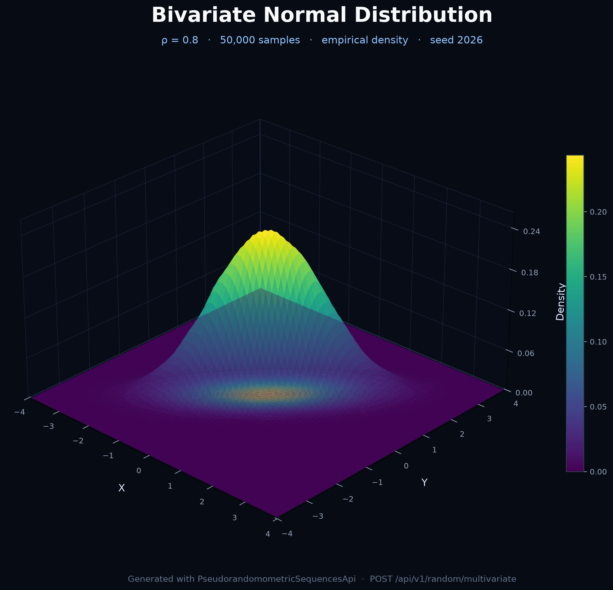

# Pseudorandomometric Sequences API

A simple, self-hosted REST API for generating sequences of pseudo-random numbers from various statistical probability distributions. Built with Kotlin, Spring Boot, and the [Apache Commons Math](https://commons.apache.org/proper/commons-math/) library.

## Documentation

* **Official Docs:** [pseudorandomometricsequences.redriottank.com](https://pseudorandomometricsequences.redriottank.com)
* **Swagger UI (Live API):** [pseudorandomometricsequences.redriottank.com/swagger](https://pseudorandomometricsequences.redriottank.com/swagger)

---

## 🚀 What It Does

This API provides a single endpoint to generate lists of floating-point numbers (`Double`) that follow a specific, well-known probability distribution. Instead of just getting uniformly random numbers (like `Math.random()`), you can request data that models real-world phenomena, such as heights (Gaussian), wait times (Exponential), or proportions (Beta).

### Key Features

* **Multiple Distributions:** Supports Uniform, Gaussian (Normal), Exponential, Gamma, Log-Normal, Beta, Weibull, Cauchy, T-Student, and Binomial distributions.
* **Joint Multivariate Distributions:** Generate correlated vectors from multivariate normal, multivariate t, Dirichlet, and multinomial distributions.
* **Two Generator Types:**
    * `general`: Uses `java.util.Random`, a standard, fast pseudo-random number generator (PRNG).
    * `secure`: Uses `java.security.SecureRandom`, a cryptographically strong PRNG (slower but less predictable).
* **Parameterizable:** You can specify the key parameters for each distribution (e.g., mean/std. dev for Gaussian).

### Common Use Cases

* **Simulation:** Powering Monte Carlo simulations.
* **Data Science:** Creating synthetic datasets for testing machine learning models.
* **Testing:** Generating realistic load for performance testing (e.g., simulating user behavior).
* **Game Development:** Modeling events like loot drops, damage rolls, or AI behavior.
* **Education:** Visualizing and understanding different probability distributions.

---

## 🛠️ API Endpoint

### `GET /api/v1/random/sequence`

Generates a sequence of pseudo-random numbers based on the provided query parameters.

#### Query Parameters

| Parameter | Type | Default | Description |
| :--- | :--- | :--- | :--- |
| `count` | Integer | `10` | The number of samples to generate. **Max: 2,000,000**. |
| `type` | String | `general` | The base generator type. Options: `general` or `secure`. |
| `distribution` | String | `uniform` | The probability distribution to sample from. |
| `param1` | Double | (varies) | The first parameter for the distribution (see table below). |
| `param2` | Double | (varies) | The second parameter for the distribution (see table below). |
| `param3` | Double | (varies) | The third parameter (used only by specific distributions like `triangular`). |
---

## 📊 Supported Distributions

The `param1`, `param2`, and `param3` fields map to the standard parameters of each distribution. If omitted, they use common defaults.

| Distribution | param1 (Default) | param2 (Default) | param3 (Default) |
| :--- | :--- | :--- | :--- |
| **arcsine** | lower bound `a` (0.0) | upper bound `b` (1.0) | - |
| **argus** | endpoint `c` (1.0) | shape `χ` (1.0) | - |
| **bates** | count `n` [int] (12) | - | - |
| **benford** | - | - | - |
| **bernoulli** | probability `p` (0.5) | - | - |
| **beta** | shape `α` (1.0) | shape `β` (1.0) | - |
| **beta-binomial** | trials `n` [int] (10) | Beta shape `α` (1.0) | Beta shape `β` (1.0) |
| **beta-negative-binomial**| successes `r` [int] (1) | Beta shape `α` (2.0) | Beta shape `β` (1.0) |
| **binomial** | trials `n` [int] (10) | probability `p` (0.5) | - |
| **bose-einstein** | `ε/kT` (1.0) | - | - |
| **burr** | shape `c` (1.0) | shape `k` (1.0) | - |
| **cauchy** | location `x₀` (0.0) | scale `γ` (1.0) | - |
| **chi** | df `k` (1.0) | - | - |
| **chi-squared** | df `k` (1.0) | - | - |
| **conway-maxwell-poisson**| rate `λ` (2.0) | dispersion `ν` (1.0) | - |
| **crystal-ball** | transition `α` (1.5) | power index `n` (2.0) | - |
| **discrete-uniform** | lower `a` [int] (0) | upper `b` [int] (9) | - |
| **double-weibull** | shape `k` (2.0) | scale `λ` (1.0) | - |
| **erlang** | shape `k` [int] (1) | rate `λ` (1.0) | - |
| **exponential** | rate `λ` (1.0) | - | - |
| **f-distribution** | num df `d1` (5.0) | den df `d2` (5.0) | - |
| **fermi-dirac** | `ε/kT` (1.0) | - | - |
| **folded-normal** | mean `μ` (0.0) | std dev `σ` (1.0) | - |
| **frechet** | shape `α` (1.0) | scale `σ` (1.0) | location `μ` (0.0) |
| **gamma** | shape `k` (1.0) | scale `θ` (1.0) | - |
| **gaussian** | mean `μ` (0.0) | std dev `σ` (1.0) | - |
| **generalized-gamma** | scale `a` (1.0) | shape `d` (1.0) | power `p` (1.0) |
| **generalized-normal** | location `μ` (0.0) | scale `σ` (1.0) | shape `β` (2.0) |
| **generalized-pareto** | location `μ` (0.0) | scale `σ` (1.0) | shape `ξ` (0.0) |
| **geometric** | probability `p` (0.5) | - | - |
| **gev** | location `μ` (0.0) | scale `σ` (1.0) | shape `ξ` (0.0) |
| **gompertz** | shape `η` (1.0) | rate `b` (1.0) | - |
| **gumbel** | location `μ` (0.0) | scale `β` (1.0) | - |
| **half-cauchy** | scale `γ` (1.0) | - | - |
| **half-normal** | scale `σ` (1.0) | - | - |
| **hyperbolic-secant** | location `μ` (0.0) | scale `σ` (1.0) | - |
| **hypergeometric** | pop `N` [int] (100) | successes `K` [int] (50)| draws `n` [int] (10) |
| **inverse-gaussian** | mean `μ` (1.0) | shape `λ` (1.0) | - |
| **irwin-hall** | count `n` [int] (12) | - | - |
| **kumaraswamy** | shape `a` (2.0) | shape `b` (2.0) | - |
| **landau** | location `μ` (0.0) | scale `σ` (1.0) | - |
| **laplace** | location `μ` (0.0) | scale `b` (1.0) | - |
| **levy** | location `μ` (0.0) | scale `c` (1.0) | - |
| **log-laplace** | loc `μ` (0.0) | scale `b` (1.0) | - |
| **log-logistic** | scale `α` (1.0) | shape `β` (1.0) | - |
| **logarithmic** | probability `p` (0.5) | - | - |
| **logistic** | location `μ` (0.0) | scale `s` (1.0) | - |
| **lognormal** | log-mean `μ` (0.0) | log-sigma `σ` (1.0) | - |
| **lomax** | shape `α` (1.0) | scale `λ` (1.0) | - |
| **maxwell-boltzmann** | scale `σ` (1.0) | - | - |
| **maxwell-juttner** | temp `θ` (1.0) | - | - |
| **moyal** | location `μ` (0.0) | scale `σ` (1.0) | - |
| **nakagami** | shape `m` (1.0) | spread `Ω` (1.0) | - |
| **negative-binomial** | successes `r` [int] (1) | probability `p` (0.5) | - |
| **negative-hypergeo** | pop `N` [int] (50) | successes `K` [int] (25)| target `r` [int] (5) |
| **noncentral-chi-sq** | df `k` (3.0) | non-centrality `λ` (1.0)| - |
| **pareto** | scale `xm` (1.0) | shape `α` (1.0) | - |
| **planck** | temp `T` (1.0) | - | - |
| **poisson** | mean `λ` (1.0) | - | - |
| **rademacher** | - | - | - |
| **rayleigh** | scale `σ` (1.0) | - | - |
| **reciprocal** | lower `a` (0.1) | upper `b` (1.0) | - |
| **relativistic-breit-wigner** | pole mass `m₀` (1.0) | decay width `Γ` (0.1) | - |
| **rice** | non-centrality `ν` (0.0)| scale `σ` (1.0) | - |
| **scaled-inv-chi-sq** | df `ν` (3.0) | scale `τ²` (1.0) | - |
| **skellam** | Poisson `μ₁` (1.0) | Poisson `μ₂` (1.0) | - |
| **skew-normal** | location `ξ` (0.0) | scale `ω` (1.0) | shape `α` (0.0) |
| **slash** | location `μ` (0.0) | scale `σ` (1.0) | - |
| **t-student** | df `ν` (10.0) | - | - |
| **trapezoidal** | min `a` (0.0) | max `d` (1.0) | plateau `frac` (0.5) |
| **triangular** | min `a` (0.0) | mode `c` (0.5) | max `b` (1.0) |
| **truncated-normal** | mean `μ` (0.0) | std dev `σ` (1.0) | half-width `w` (3.0) |
| **tsallis** | temp `T` (0.1) | exponent `n` (7.0) | - |
| **tukey-lambda** | shape `λ` (0.0) | - | - |
| **uniform** | min `a` (0.0) | max `b` (1.0) | - |
| **voigt** | location `μ` (0.0) | Gaussian `σ` (1.0) | Lorentzian `γ` (0.5) |
| **von-mises** | mean dir `μ` (0.0) | concentration `κ` (1.0) | - |
| **weibull** | shape `k` (1.0) | scale `λ` (1.0) | - |
| **wigner-semicircle** | radius `R` (1.0) | - | - |
| **yule-simon** | shape `ρ` (1.5) | - | - |
| **zipf** | elements `n` [int] (10)| exponent `s` (1.0) | - |

## 📋 Examples

Using `curl` from the command line.

**Example 1: Get 5 numbers from a Gaussian (Normal) distribution with a mean of 100 and std. dev of 15.**
```bash
curl "[https://pseudorandomometricsequences.redriottank.com/api/v1/random/sequence?count=5&distribution=gaussian&param1=100&param2=15](https://pseudorandomometricsequences.redriottank.com/api/v1/random/sequence?count=5&distribution=gaussian&param1=100&param2=15)"
```

```json
{
  "type": "general",
  "count": 5,
  "distribution": "gaussian",
  "sequence": [
    98.138,
    115.221,
    89.445,
    103.002,
    122.910
  ]
}
```

**Example 2: Get 3 numbers from a Beta distribution with α=2 and β=5.**

```bash
curl "[https://pseudorandomometricsequences.redriottank.com/api/v1/random/sequence?count=3&distribution=beta&param1=2&param2=5](https://pseudorandomometricsequences.redriottank.com/api/v1/random/sequence?count=3&distribution=beta&param1=2&param2=5)"
```
```json
{
  "type": "general",
  "count": 3,
  "distribution": "beta",
  "sequence": [
    0.345,
    0.199,
    0.401
  ]
}
```
**Example 3: Get 4 numbers from an Exponential distribution using the secure generator.**

```bash
curl "[https://pseudorandomometricsequences.redriottank.com/api/v1/random/sequence?count=4&distribution=exponential&type=secure](https://pseudorandomometricsequences.redriottank.com/api/v1/random/sequence?count=4&distribution=exponential&type=secure)"
```
```json
{
  "type": "secure",
  "count": 4,
  "distribution": "exponential",
  "sequence": [
    0.891,
    1.422,
    0.310,
    2.109
  ]
}
```

## 🧮 Independent Multi-Variable Generation

> **These variables are independent.** This endpoint bundles several univariate sequences into
> one response, but it does not create correlations between them. For statistically dependent
> components, use [Joint Multivariate Generation](#-joint-multivariate-generation) below.

### `POST /api/v1/random/sequences`

Generates multiple named variables in a single request. Each variable can use its own
distribution and parameters. When a request-level `seed` is provided, every variable gets a
deterministically derived seed, so the whole request is reproducible. A variable-level `seed`
overrides its derived seed and makes that variable reproducible on its own.

#### Request Body

| Field | Type | Default | Description |
| :--- | :--- | :--- | :--- |
| `count` | Integer | `10` | Samples per variable. **Total samples across all variables: max 2,000,000**. |
| `type` | String | `general` | Base generator type: `general` or `secure`. |
| `seed` | Long | (random) | Request-level seed used to derive each variable's seed. |
| `variables` | Array | (required) | One or more variable definitions. |
| `variables[].name` | String | `variable1`, ... | Optional unique variable name. |
| `variables[].distribution` | String | (required) | Distribution to sample from. |
| `variables[].param1` | Double | (varies) | First distribution parameter. |
| `variables[].param2` | Double | (varies) | Second distribution parameter. |
| `variables[].param3` | Double | (varies) | Third distribution parameter. |
| `variables[].seed` | Long | (derived) | Optional seed for this variable only. |

#### Example: generate temperature and humidity together

```bash
curl -X POST "https://pseudorandomometricsequences.redriottank.com/api/v1/random/sequences" \
  -H "Content-Type: application/json" \
  -d '{
    "count": 3,
    "type": "general",
    "seed": 42,
    "variables": [
      {"name": "temperature", "distribution": "gaussian", "param1": 20, "param2": 2},
      {"name": "humidity", "distribution": "uniform", "param1": 30, "param2": 60}
    ]
  }'
```

```json
{
  "type": "general",
  "count": 3,
  "seed": 42,
  "variables": [
    {
      "name": "temperature",
      "distribution": "gaussian",
      "seed": -5025562857975149833,
      "sequence": [18.349, 14.874, 18.758]
    },
    {
      "name": "humidity",
      "distribution": "uniform",
      "seed": -5843495416241995736,
      "sequence": [36.582, 31.589, 54.264]
    }
  ]
}
```

The existing single-variable `GET /api/v1/random/sequence` endpoint remains fully supported.

## 🔗 Joint Multivariate Generation

### `POST /api/v1/random/multivariate`

Generates vector-valued observations from a joint distribution. Unlike the independent
multi-variable endpoint, the values inside each vector may be statistically dependent. The
response contains one array per observation, in the order given by `variableNames`.

`GET /api/v1/distributions/multivariate` lists the available joint distributions.

#### Supported joint distributions

| Distribution | Required fields | Description |
| :--- | :--- | :--- |
| `multivariate-normal` | `covariance` (optional `mean`) | Joint normal N(μ, Σ). Non-zero off-diagonal covariance produces correlated components. |
| `multivariate-t` | `covariance`, `degreesOfFreedom` (optional `mean`) | Joint Student's t with scale matrix Σ and ν > 0. |
| `dirichlet` | `concentration` | Probability vectors whose components are non-negative and sum to 1. |
| `multinomial` | `trials`, `probabilities` | Count vectors whose components sum to `trials`. |

#### Request Body

| Field | Type | Default | Description |
| :--- | :--- | :--- | :--- |
| `count` | Integer | `10` | Number of vector observations. |
| `type` | String | `general` | Base generator type: `general` or `secure`. |
| `seed` | Long | (random) | Seed used to reproduce the sequence. |
| `distribution` | String | (required) | Joint distribution name. |
| `mean` | Double[] | zeros | Mean/location vector for `multivariate-normal` and `multivariate-t`. |
| `covariance` | Double[][] | (required for normal/t) | Symmetric positive-definite covariance/scale matrix. |
| `degreesOfFreedom` | Double | (required for t) | ν > 0. |
| `concentration` | Double[] | (required for dirichlet) | Concentration vector α, all values > 0. |
| `trials` | Integer | (required for multinomial) | Number of trials per observation. |
| `probabilities` | Double[] | (required for multinomial) | Category probabilities, non-negative and summing to 1. |
| `variableNames` | String[] | `x1`, `x2`, ... | Optional component names; length must match the dimension. |

**Limits:** `count` must be positive, and `count × dimension` must not exceed 2,000,000.

#### Example: correlated bivariate normal

```bash
curl -X POST "https://pseudorandomometricsequences.redriottank.com/api/v1/random/multivariate" \
  -H "Content-Type: application/json" \
  -d '{
    "count": 3,
    "seed": 42,
    "distribution": "multivariate-normal",
    "mean": [0.0, 0.0],
    "covariance": [[1.0, 0.8], [0.8, 1.0]],
    "variableNames": ["height", "weight"]
  }'
```

```json
{
  "type": "general",
  "count": 3,
  "distribution": "multivariate-normal",
  "dimension": 2,
  "seed": 42,
  "variableNames": ["height", "weight"],
  "sequence": [
    [1.4325228983022713, 1.3330190510448872],
    [-1.3446476540230368, -1.4149154862577822],
    [0.5574866615513397, 0.7380022637698389]
  ]
}
```

The off-diagonal `0.8` in the covariance matrix means the two components are positively
correlated. Set it to `0.0` for independent components.

#### Example: Dirichlet probability vectors

```bash
curl -X POST "https://pseudorandomometricsequences.redriottank.com/api/v1/random/multivariate" \
  -H "Content-Type: application/json" \
  -d '{
    "count": 2,
    "seed": 7,
    "distribution": "dirichlet",
    "concentration": [2.0, 5.0, 3.0]
  }'
```

#### 3D visualization

The following render was produced from 50,000 samples returned by this endpoint:



Reproduce it with the API running:

```bash
python3 scripts/render_multivariate_normal_3d.py \
  --url http://localhost:8080 \
  --count 50000 \
  --seed 2026
```

The script requires `numpy` and `matplotlib`.

## ⚠️ Important Disclaimers & Usage Limits

**Service Availability**

This is a self-hosted service provided for free. It is not a high-availability, enterprise-grade API and may experience downtime or interruptions without notice.

**Request Throttling**

Please avoid aggressive polling or sending a large number of requests in a short period. Users who abuse the service (e.g., in a way that risks a DDoS) may have their IP address rate-limited or banned to protect the stability of the service for others.

**Generation Limit**
The API has a hard limit of 2,000,000 (2 million) numbers per single request.

If you require a larger dataset or more consistent availability, you have two options:

1. **Contact me** to discuss your use case. You can do it through my email albertoplazamontesdm@gmail.com

2. **Run it on your own computer**: This project is open-source. You can download the latest release (or link your repo), modify the count validation limit in RandomService.kt, and run the API on your own machine for unlimited and private use.
